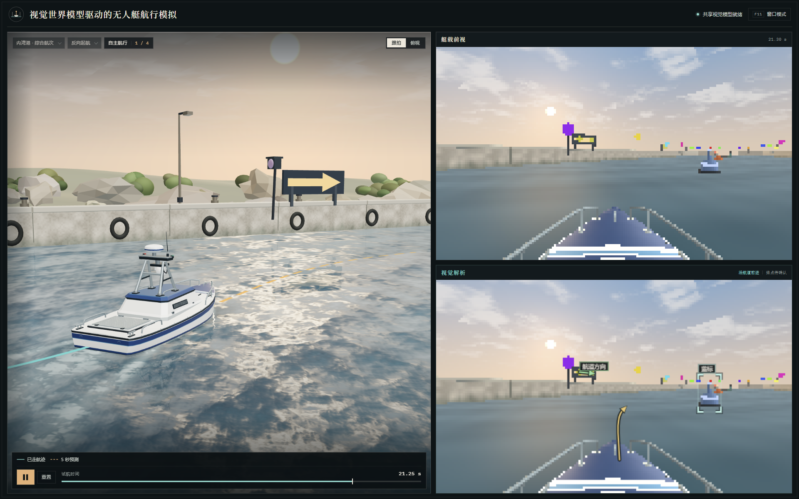
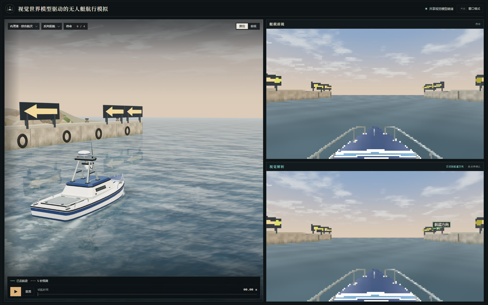
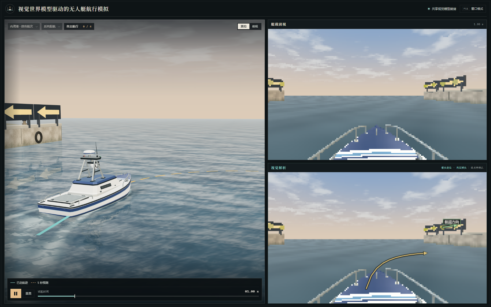
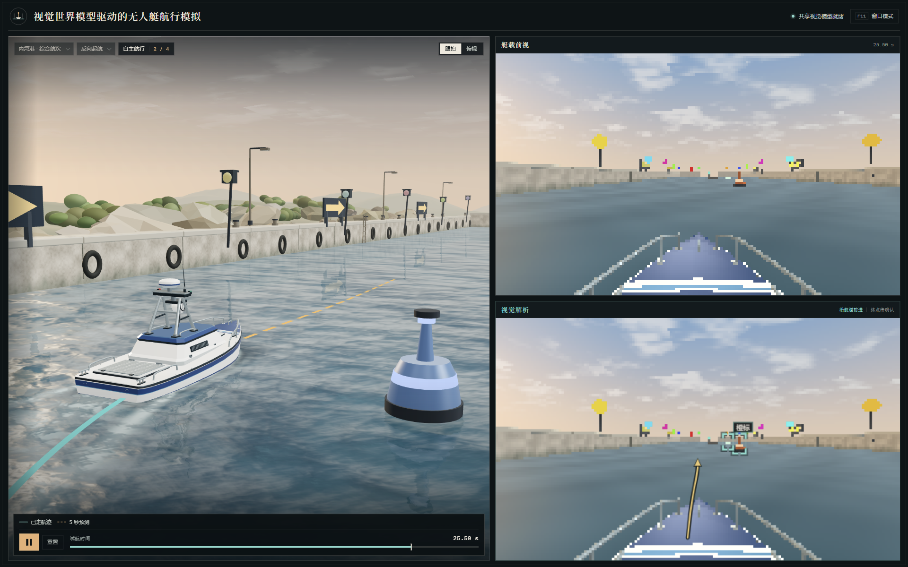
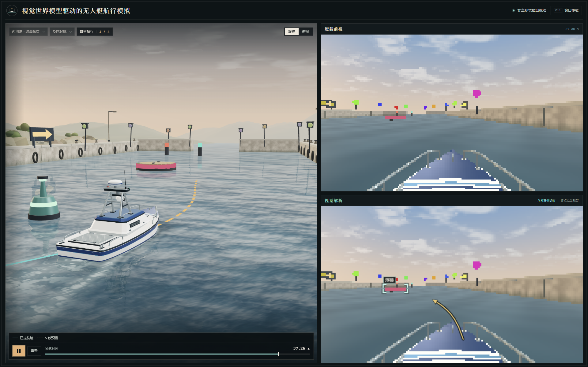
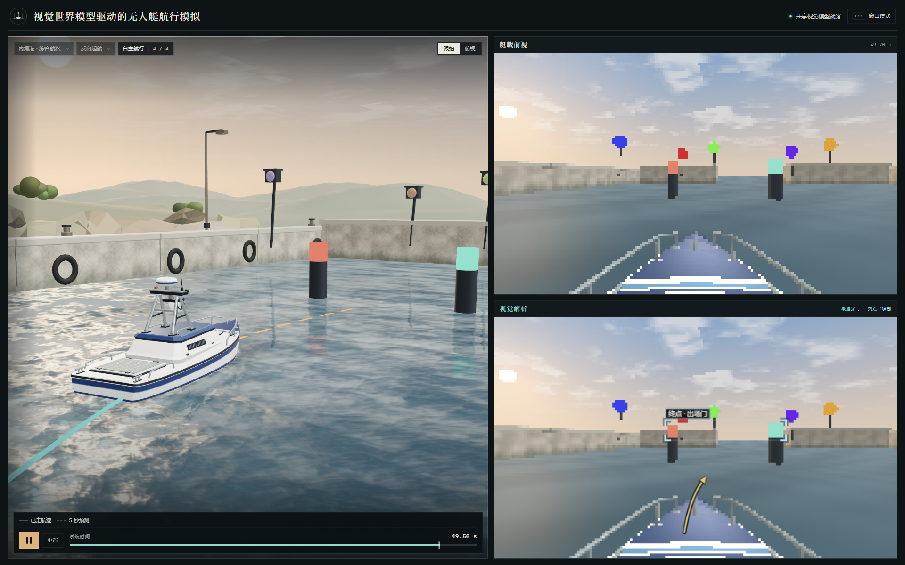
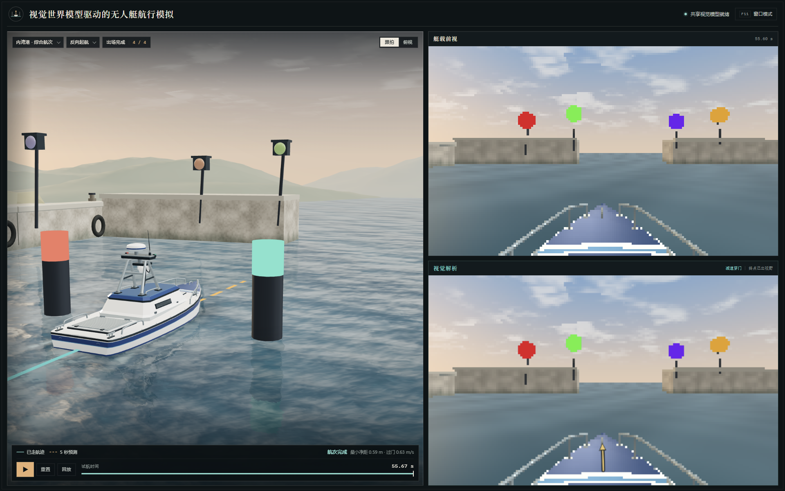

# 视觉世界模型驱动的无人艇航行模拟

Three.js + Vite 渲染港池，船模由 `createVessel()` 在运行时生成。基础试航和两座综合港池共用一套视觉状态估计与动作推演权重，所有推理都在浏览器或桌面 WebView 内完成。

[Windows x64 免安装版 v0.1.0](https://github.com/ZHT1235456/USV-world-model-demo/releases/tag/v0.1.0) · [中文开发日志 PDF](docs/development-log.pdf) · [LaTeX 源文件](docs/development-log.tex)



## 打开应用

在具有 WebView2 Runtime 的 Windows x64 上，下载发布页中的 EXE 并双击运行。单文件约 **11.56 MB**，离线运行所需的前端资源、ONNX 权重和 WASM 推理运行时均已内嵌。程序默认全屏，按 F11 在窗口和全屏之间切换。

在三维画面左上角选港池，然后点击下方的播放图标。跟拍和俯视可在航行中切换。暂停后拖动时间尺可查看预测艇影，航次结束后可回放整段过程。

在港池旁选择「反向起航」，可让艇以朝向背离出场门的姿态出发。通道两侧的箭头指向出场方向，视觉解析会标出画面中识别到的航道方向，并显示计划向左还是向右掉头。

| 场景 | 航标顺序 | 后续任务 |
| --- | --- | --- |
| 外堤港 | 绿标 → 橙标 → 蓝标 | 识别并绕开浮排，以不超过 0.85 m/s 穿过 2.76 m 宽的门 |
| 内湾港 | 黄标 → 蓝标 → 橙标 → 绿标 | 识别并绕开浮排，以不超过 0.85 m/s 穿过 2.68 m 宽的门 |
| 基础绕标 | 橙标 → 黄标 → 绿标 | 通过出场门 |

门宽按两根门柱的中心线计，评分扣除门柱半径和艇身在门线上的投影宽度。航标与浮排的最小艇身净距要求均为 0.50 m。航次结束后再次点击播放图标会改变起步状态和临时浮排位置。

「艇载前视」与「视觉解析」随窗口尺寸调整，按原始 **5:3** 比例铺满各自区域。窄窗口会把两块视觉画面排到三维场景下方。视觉解析用绿色箭头标出从黄色指示牌识别的航道方向，并框出航标和浮排。出现一对出场门柱的色带时，框出「终点 · 出场门」。金黄色曲线箭头显示控制器选中的预测航迹，窗顶显示掉头、修正航向、避障或减速穿门等动作。

## 一次完整航次

这六张截图记录了 v0.1.0 免安装版的一次内湾港反向航次。无人艇用时 **55.67 s**，通过 **4/4** 个航标，最小艇身净距 **0.59 m**，以 **0.63 m/s** 通过出场门。点击图片可查看原图。

| 1. 选定内湾港与反向起航 | 2. 识别黄色方向箭头并向右掉头 |
| --- | --- |
| [](docs/images/voyage/01-ready.png) | [](docs/images/reverse-start.png) |
| **3. 已通过两个航标** | **4. 从浮排右侧绕行** |
| [](docs/images/voyage/03-buoys.png) | [](docs/images/voyage/04-avoidance.png) |
| **5. 识别出场门并减速** | **6. 通过四个航标并完成航次** |
| [](docs/images/voyage/05-gate.png) | [](docs/images/voyage/06-finish.png) |

## 观测与控制

控制 Worker 每帧收到前视 RGB、已发出的转速与舵角指令、采样时间。换港池时提供已测绘的固定岸标、航标位置、通过侧和出场门参数。仿真坐标用于渲染、训练监督和独立评分。

程序用可见岸标和标定相机估计艇位姿。CNN 与 GRU 处理前视影像和船体坐标系下的运动历史，校正位姿并估计运动状态。共享的动作转移模型保留纵荡、横荡和艏摇耦合，以 0.25 秒为步长预测未来 5 秒。每次决策推演 15 组动作，首次确认浮排时额外对另一侧推演 15 组动作。

箭头的尖端与尾部用不同深浅的黄色编码。程序从 RGB 帧读取这些定位点并与海图匹配，估计艇的位置和艏向。反向入航时，规划器用同一套动力学权重推演左右掉头的 14 秒轨迹，按转动后整个艇身与岸界的净距选侧。艇身转过横向后降低转速，确认已朝航道内侧移动再恢复巡航。航次判定也检查整个艇身是否触碰岸界。

临时浮排的位置由相机中已知半径的环形色带反推，至少四次一致观测后才用于规划。绕行侧由两侧候选轨迹的净距和跟踪代价决定，穿门则按海图和限速提前回正并减速。验证范围覆盖具有已知岸标的模拟港池和带色带的静态浮排。

## 开发与构建

```powershell
npm ci
npm run dev
```

Vite 默认监听 `127.0.0.1:1420`。`npm run build` 生成静态网页。`npm run desktop` 通过 Tauri 2 生成免安装的可执行文件，输出到 `src-tauri/target/release/视觉世界模型驱动的无人艇航行模拟.exe`。桌面构建需要 Rust 和 MSVC。已导出的权重位于 `public/models`。

## 采集、训练与评估

启动 Vite 后，在装有 PyTorch、Playwright 和 `training/requirements.txt` 其余依赖的 Python 环境中执行以下命令。采集和评估使用本机 Edge。

```powershell
python training/collect.py --start 1000 --count 60
python training/collect.py --start 2000 --count 15
python training/collect.py --start 3000 --count 12
python training/train.py --epochs 9 --threads 5
python training/evaluate.py --count 3 --ablation
python training/evaluate.py --reverse-start --count 12 --ablation
```

五种布局用于拟合和验证。外堤港和内湾港的完整布局都只用于评估。闭环脚本在同一 Worker 内切换港池，记录权重的 SHA-256、逐标通过、首次浮排估计、绕行侧、最小岸界净距、相机首次确认终点的时间和过门速度。遮蔽浮排色带的对照保留同一航次的场景和参数。

已发布的视觉估计器使用带箭头的航次重训，训练集包括顺向、反向和侧向起航各 20 趟。已有 PyTorch 动力学检查点和 ONNX 导出时，可用 `--reuse-motion` 复用这两项。训练指标和 ONNX 一致性检查结果保存在 `public/models/manifest.json`。

评估脚本将顺向结果写入 `artifacts/shared-evaluation.json`，将反向航次及遮蔽箭头的对照结果写入 `artifacts/shared-heading-evaluation.json`。对照包含首次舵令前的真实艏向、视觉估计和检出的箭头色块数量。真实艏向仅用于评估。

v0.1.0 在三个场景中通过 **12/12 趟顺向**和 **39/39 趟反向**测试，全部在穿门前从相机画面识别到终点。反向航次的最小岸界净距为 **0.519 m**，第一舵前最大艏向误差为 **0.662°**。

遮蔽方向箭头后，三趟对照在第一舵前的艏向误差为 178.8° 至 179.9°，其中内湾港航次因触碰岸界终止。遮蔽浮排色带的两趟对照均未检出浮排，艇身净距未达标。

桌面版从仅有可执行文件的目录离线启动，验证了 F11 双向切换、从内湾港反向起航、凭箭头定位掉头、完成综合航次及回放。

## 编译开发日志

在包含 CTeX、Fandol 字体和 PGF/TikZ 的 TeX Live 环境中，通过 XeLaTeX 运行两次以解析交叉引用。

```powershell
cd docs
xelatex -halt-on-error development-log.tex
xelatex -halt-on-error development-log.tex
```
